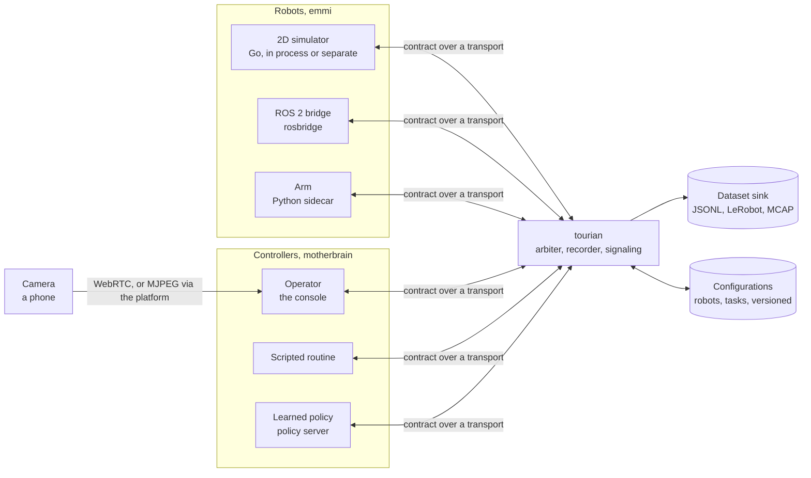

# Architecture

How tourian works, as built, with the planned shape below it until it is. [SCOPE.md](SCOPE.md) says what, in which order and what is still missing; [AGENTS.md](AGENTS.md) how to work on it.

## Built

### M0 — the toolchain and the first contract

One repository, three languages, one contract. The Go module `github.com/vlumi/tourian` holds the platform binary and the adapters; an npm workspace at the root holds the console and the generated TypeScript as a package of its own, `@tourian/contract` in `gen/ts` (its `package.json` is the one hand-written file there, which `make generate` keeps), so the console imports contract types the way it imports any dependency and the bundler's root is the repository; the Python under `gen/python` serves the sidecars.

**The contract** is `proto/tourian/v1/`: `header.proto` (stamp and frame id, as std_msgs/Header), `geometry.proto` (Vector3, Point, Quaternion, Pose, Twist, as geometry_msgs) and `robot.proto` (Capabilities with velocity limits and the command timeout, VelocityCommand with a sequence number, Observation with pose, velocity, joints and battery and the sequence of the last command it reflects, JointState as parallel arrays, Heartbeat as the dead-man signal, Stop). `make generate` writes Go with `protoc-gen-go` into `gen/go`, TypeScript with `protoc-gen-es` into `gen/ts` and Python with buf's remote plugin into `gen/python`; all are committed, and `make generate-check` fails CI if they drift from the `.proto` files.

**The platform binary**, `cmd/tourian`, is an HTTP server with a health endpoint, the mount point for the WebSocket transport of M1.

**The console** is Next.js with the App Router. Its first page rendered the name and listed the messages of the contract from the generated schemas, proving the generation path end to end; M1 replaced it with the control room.

**The gate**, `make ci`, is what hosted CI runs: golangci-lint with gofmt and goimports, buf lint and format, Prettier, oxlint, tsc, markdownlint, ruff, the generation check, the Go tests under the race detector, the Vitest and pytest tests, the Go and Next.js builds, and the contract tests against the Go adapters. `make tools` installs buf, protoc-gen-go and golangci-lint into `bin/` at the versions pinned in the Makefile; `make screenshot` builds and serves the console and captures it with headless Chrome.

### M1 — drive

**The shape, as built.** The platform is one Go process, `cmd/tourian`, whose `hub` is a switchboard: robot adapters connect to `/robot` and announce their capabilities in their first frame; consoles connect to `/console` and are told about every robot known. Commands, joint commands, heartbeats and stops are routed to the robot they name, driving only when the arbiter admits the console sending it; observations and acknowledgements fan out to every console. The hub never looks inside a message beyond the robot id and, for video signaling, the console's id, so what sits on either side can change without it. Each peer writes from its own goroutine with a bounded queue, and one that cannot keep up is dropped rather than slowing the others; the robot behind a dropped connection stops on its own timeouts.

**The transport** is WebSocket, `transport/ws`: one `Envelope` per binary frame, the Envelope being the contract's one-of over every message that crosses a seam. The same package serves the hub, the simulator and the tests; the console decodes the same frames with the generated TypeScript.

**The simulator**, `emmi/zebes`, is a differential drive in a square arena: pose, body velocity, wheel joints whose angles and speeds follow from the drive, and a battery that drains with effort. It is stepped by an injected clock, so the tests run in no time, and runs at 50 Hz with observations at 20 Hz when connected. It connects to the platform as a client, in its own process (`cmd/zebes`) or in the platform's (`tourian -sim`), and reconnects when the platform goes away.

**Safety lives in the simulator.** It is held still until the first heartbeat; it stops when no command has arrived within the command timeout (500 ms) or no heartbeat within the heartbeat timeout (1 s); and a stop is applied from the read loop the moment it arrives, zeroing the velocity and discarding every command queued for the next step. Every observation carries the halt reason, so the console can say why the robot is not moving. The console contributes the dead-man signal only: it sends a heartbeat with every command while the operator is engaged and the window has focus, and losing focus disengages.

**The console** keeps one store (zustand) that the connection writes and the components read: the robots announced, the latest observation of the selected one, its trail, the last 120 samples of speed, turn rate, battery and latency, about six seconds, and the operator's state. A driver loop at 20 Hz reads the keyboard and the gamepad, and while engaged sends a heartbeat and a velocity command scaled to the robot's limits. Latency is the round trip of each command: the moment it is sent to the moment its acknowledgement comes back, matched by sequence number. The world is a canvas redrawn on every store change; the telemetry panel shows the figures with sparklines beside them.

### M2 — see

**The camera is a peer like the robot.** A phone opens the console's `/camera` page, which takes the camera and connects to the hub's `/camera` endpoint, announcing which robot it is the eyes of. The hub learns cameras as it learns robots and tells every console; the console's video view, above the world, shows the camera of the selected robot over the path chosen.

**WebRTC is peer to peer, the platform only signals.** The console offers a receive-only connection; the hub stamps the offer with the console's id and routes it to the robot's camera, which answers with its track; the answer and the ICE candidates route back by the same id. Candidates that arrive before their description wait for it. The platform never touches the media, which is also why nothing about it is recorded yet. There are no STUN or TURN servers: everything is on one network until the platform is reachable from elsewhere.

**MJPEG goes through the platform.** When a console asks, the camera page repaints its frames onto a canvas 640 wide, encodes each as JPEG at quality 0.7 and sends them at 15 fps as `VideoFrame` messages; the hub fans them out to every console, and the viewer shows each as it arrives. The camera stops when the last console that asked has left, which the hub tells it on the console's behalf. This path puts the frames in the platform's hands, which is what recording will need.

**Measuring the two.** With `?clock=1` the camera page composes a band of 32 black and white blocks across the top of every frame, encoding the time it was composed, and streams the composition instead of the raw camera. With `?measure=1` the console reads the band back from every new frame on a fast timer, once per stamp, and summarizes the frames' ages; the result is the time from composition to display on the viewer's side, which covers encoding, the path, decoding and rendering but not the camera's sensor or the screen, and means something only when both pages share a clock, as they do on one machine. `make results-video` runs both pages in one headless Chrome with a fake camera, a window each so neither is throttled as a background tab, and writes the figures with date, commit and machine under `docs/results/`. The first run gave WebRTC a median of 30 ms with a spread of a few ms, and MJPEG 36 ms with a p95 near 60 ms.

### M3 — record

**The recorder is a tap on the hub.** Every message the hub receives, from any peer, is handed to the recorder before routing, on a channel it drains from its own goroutine so the hub never waits for the disk. A console asks to record a robot; from then on each observation of that robot becomes a frame carrying the velocity command in force and the sequence of the latest picture, until the console asks to stop. Pictures come over the MJPEG path, which the recorder requests from the camera for itself, as one more peer, and releases when it stops; WebRTC stays peer to peer and is not recorded. The recorder reports what it is writing to every console once a second, and a flag marks an episode bad with a note, during or after.

**The dataset sink is a seam with three implementations, since M6.** JSONL came first: a directory per episode with `meta.json`, `frames.jsonl` of `EpisodeFrame` rows, the pictures as JPEG files and `video.jsonl` indexing them, all in the contract's own messages serialized as JSON, so the layout is readable by eye and by anything. LeRobot came second, the v3.0 layout, one dataset per robot under `data/lerobot/<name>/<robot id>/` since a dataset's state vector is laid out from one robot's joints: `meta/info.json` with the features (`observation.state` as pose, body velocity, one entry per joint and the battery; `action` as the commanded velocities; the camera as a video feature), `meta/tasks.parquet` with the pandas index metadata its reader expects, `meta/stats.json` folded across episodes the way LeRobot's own aggregation does, one Parquet data file and one episodes row per episode under `data/` and `meta/episodes/`, and one MP4 per episode under `videos/`, encoded with ffmpeg from the picture in force at each frame so the video runs at the frame rate and lines up with the rows. The layout has no place for a flag, so `meta/tourian.json` maps episode ids to indices and carries the flags. Frames are stamped at the nominal rate, as LeRobot stamps them; the true offsets stay in the JSONL layout.

**Browsing** is HTTP from the platform: the list, one episode's metadata, its frames and video index as written, and its pictures. The console's episodes page lists them and replays one, the world drawn by the same code as the live view beside the picture in force, scrubbed or played at the speed it happened.

### M4 — hand over

**The controller seam.** A controller inside the platform is anything that can describe itself and turn an observation into a twist: `motherbrain.Controller`. Two exist: the scripted square, which drives a leg and turns a quarter by the clock on the observations and so needs no state, and the policy client, which posts the observation as JSON to a policy server's `/act` and reads a twist back; `cmd/policy` stands in for a learned policy by steering home to the origin over the same protocol, so a real server replaces it without the platform noticing. The operator is the third kind of controller and speaks through the hub as before; nothing about driving changed for the console.

**The arbiter** keeps one answer per robot to who is driving. It is a tap on the hub, like the recorder, and runs on its own goroutine with its own inbox, skipping observations that piled up so a controller acts on the latest. A console hands a robot to a controller by name with a `ControlRequest`; the operator takes over by driving, since the hub asks the arbiter whether to admit each command, joint command and heartbeat from a console, and the first admitted one makes that console the holder and remembers who held it before; releasing hands the robot back to that controller, or to nobody. One operator at a time: while a console's operator holds a robot, another console's driving is refused before any tap sees it, and when the holder falls silent for a second, by disconnecting or otherwise, the robot is left in nobody's hands rather than resumed by whoever held it before. An emergency stop from a console takes the robot out of every hand, the remembered one included, so no controller drives on after it; the operator must hand it over again. While a controller inside the platform holds a robot, the arbiter calls it on every observation with a 40 ms budget, one call in flight per robot so a slow one holds up nobody else, and sends the robot a heartbeat and the command; a controller that fails or is late sends nothing, is complained about at most once a second, and the robot's own timeouts hold it still, so the safety story is unchanged by who is driving. Every change of hands is published as a `ControlState` with the holder, since when, and the controllers available.

**Publishing.** The platform's own voice is `Publish` on the hub: the message goes to every tap and every console, and the latest of its kind per robot is retained for consoles that join later, so a console always knows who holds a robot and whether it is being recorded. Taps also learn the source of each message, a robot, a camera, a console by id or the platform. The recorder sees the control states too and stamps the holder on every frame, so each change of hands is in the episode and the replay shows who was driving at any moment.

**The console** shows the holder and since when in a control section, with a button per controller to hand the robot to, and explains that engaging takes over and releasing hands back; releasing sends the request along with a zero command.

### M5 — many

**Several robots** were never special for the platform: the hub keys robots, cameras and capabilities by robot id, and the arbiter and the recorder hold their state per robot. What M5 added is on the edges. The simulator takes a start pose, and the platform runs several (`-sims`) with their own ids, names and positions; the console's store keeps the latest observation, control state and episode status of every robot and the trail and history of the selected one only, and a fleet strip shows a card per robot with its holder, whether it is recording, its halt or driving state, its battery and its latest picture when frames are passing by. Clicking a card selects the robot for driving; the world draws the others dimly.

**Configurations** are versioned files: `data/config/robots/<id>/v<N>.json` and `data/config/tasks/<id>/v<N>.json`, each a `RobotConfig` or `TaskConfig` as JSON, every save a new version beside the earlier ones, so an episode can name the version it was recorded on and the file is still there to read. The platform serves them over HTTP, the current ones as lists and every version of one, and saving is a PUT. A new robot configuration is also published to consoles and retained, so the console drives within the configured limits at once: a configuration can lower a robot's limits, never raise them. The console's Config page edits both kinds; the recording controls offer the configured tasks, and the recorder stamps the robot's and the task's current versions on the episode, taking the task's name from the configuration.

### M6 — real

**The robot seam has its second implementation.** `emmi/rosbridge` speaks the rosbridge protocol to a ROS 2 robot: velocity commands become `geometry_msgs/msg/Twist` on `/cmd_vel`, odometry, joint states and battery state become observations. It publishes the twist every 50 ms, zero within that tick of the operator not being heard, and a last zero on the way out whatever the reason, since a plain ROS robot keeps doing what it was last told; that is the adapter's half of the safety story, and the guard that decides when is `emmi/safety`, extracted from the simulator for every adapter to share. `rosbridgetest` is a simulated ROS robot behind the same protocol, a differential drive that applies the last `/cmd_vel`; `cmd/rossim` runs it on a port for driving from the console, and the tests run it on a port of their own.

**The contract tests** in `emmi/contracttest` are what every adapter must do, exercised through a real hub with a console client: announce, drive on command, stop when commands stop, stop when heartbeats stop, stop at once on an emergency stop ahead of five queued commands. Both Go adapters pass them, and `make contract` runs them as part of `make ci`; the Python sidecar has the same test in pytest.

**MCAP is the third sink.** One file per episode: `/observation`, `/action` and `/controller` carry the contract's messages as protobuf with the FileDescriptorSet embedded as the schema, `/camera` and `/pose` carry `foxglove.CompressedImage` and `foxglove.PoseInFrame` as JSON with their schemas, so Foxglove's panels show them without being told how. Log times are the episode's start plus each frame's offset; a metadata record names the episode and carries its flag, and a flag set after the file is closed is written beside it.

**The arm sidecar** is Python, under `sidecars/arm`, because the drivers of physical arms tend to be. The contract is generated for Python with buf's remote plugin under `gen/python`. `ArmDriver` is what the sidecar needs from an arm's own driver: named joints, positions, a target to move toward and a stop that holds; `FakeArm` stands in. The sidecar announces the arm, acknowledges each `JointCommand` on arrival, moves toward the target while the operator is heard and holds the arm the moment not, through a guard with the same semantics as the Go one. It is tested end to end against a stand-in platform over WebSocket. The hardware retest waits for an arm, and the console has no joint controls yet, so an arm is driven by a controller inside the platform or a console that speaks `JointCommand`.

### Layout

| Directory | What it holds |
| --- | --- |
| `proto/` | the contract, and `buf` configuration |
| `gen/` | generated Go, TypeScript and Python, committed; `gen/ts` is the npm package `@tourian/contract` |
| `cmd/tourian` | the platform binary |
| `cmd/zebes` | the simulator as its own process |
| `cmd/policy` | a stand-in policy server that steers home |
| `cmd/rosbridge` | the rosbridge adapter as its own process |
| `cmd/rossim` | a simulated ROS 2 robot behind the rosbridge protocol |
| `config/` | the versioned configurations of robots and tasks, and their HTTP |
| `emmi/zebes` | the simulated robot: world and the connection to the platform |
| `emmi/rosbridge` | the adapter for a ROS 2 robot through rosbridge; `rosbridgetest/` the simulated one |
| `emmi/safety` | the guard every adapter shares |
| `emmi/contracttest` | what every adapter must do |
| `hub/` | the platform's routing between robots, cameras and consoles, with taps for the rest of the platform |
| `episode/` | the recorder, the JSONL sink, the HTTP for browsing; `lerobot/` the LeRobot v3.0 sink, `mcap/` the MCAP sink |
| `motherbrain/` | the controller seam and the arbiter; `script/` the square, `policy/` the client of a policy server |
| `transport/ws` | contract messages over WebSocket |
| `console/` | the Next.js console: `platform/` connection and store, `drive/` inputs and latency, `world/` the canvas, `telemetry/` the panel, `video/` the viewers, the camera page's serving side and the clock band, `record/` the recording controls, `control/` the holder and the handover, `fleet/` the strip of robots, `config/` the configuration page, `episodes/` the list and the replay, `test/` the Vitest setup; `app/` the pages: the control room, `camera` for a phone, `episodes` and `episodes/[id]`, `config` |
| `sidecars/arm` | the Python sidecar for a physical arm |
| `scripts/` | what the make targets run |
| `docs/` | screenshots, and the measurements under `results/` |

### The shape of it

The platform is one Go process in the middle. Robot adapters connect to it and announce their capabilities; consoles connect to it and see the fleet; controllers hold robots through it. The contract is the same on every edge, so the platform forwards, records and arbitrates without knowing what kind of robot or controller is on the other side. The camera is a phone's for now; a camera on the ROS robot or the arm is not bridged yet.

### The contract

One Protobuf package, `tourian.v1`, in files under `proto/tourian/v1/`: `header` and `geometry` in ROS 2 shapes, `robot` (capabilities, observations, velocity and joint commands, acknowledgements, heartbeat, stop), `video` (camera announce, signaling, frames), `control` (who holds a robot, handing over and releasing), `episode` (recording start and end, status, flags, the frame and metadata layout), `config` (robot and task configurations with versions), and `transport` (the Envelope every frame carries).

## Planned

### Where the rest will be

| Directory | What it will hold |
| --- | --- |
| `transport/<other>` | the other transports beside `ws`, for comparison |
