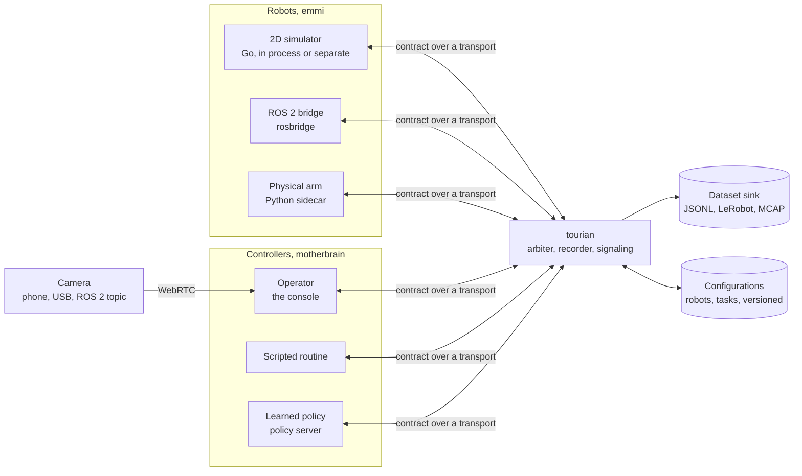

# Architecture

How tourian works, as built, with the planned shape below it until it is. [SCOPE.md](SCOPE.md) says what, in which order and what is still missing; [AGENTS.md](AGENTS.md) how to work on it.

## Built

### M0 — the toolchain and the first contract

One repository, two languages, one contract. The Go module `github.com/vlumi/tourian` holds the platform binary and, later, the adapters; an npm workspace at the root holds the console and the generated TypeScript as a package of its own, `@tourian/contract` in `gen/ts`, so the console imports contract types the way it imports any dependency and the bundler's root is the repository.

**The contract** is `proto/tourian/v1/`: `header.proto` (stamp and frame id, as std_msgs/Header), `geometry.proto` (Vector3, Point, Quaternion, Pose, Twist, as geometry_msgs) and `robot.proto` (Capabilities with velocity limits and the command timeout, VelocityCommand with a sequence number, Observation with pose, velocity, joints and battery and the sequence of the last command it reflects, JointState as parallel arrays, Heartbeat as the dead-man signal, Stop). `buf generate` writes Go with `protoc-gen-go` into `gen/go` and TypeScript with `protoc-gen-es` into `gen/ts`; both are committed, and `make generate-check` fails CI if they drift from the `.proto` files.

**The platform binary**, `cmd/tourian`, is an HTTP server with a health endpoint, the mount point for the WebSocket transport of M1.

**The console** is Next.js with the App Router. Its one page renders the name and lists the messages of the contract from the generated schemas, which proves the generation path end to end: proto to TypeScript to a server-rendered page.

**The gate**, `make ci`, is what hosted CI runs: golangci-lint with gofmt and goimports, buf lint and format, Prettier, oxlint, tsc, markdownlint, the generation check, Go and Vitest unit tests, and the Go and Next.js builds. `make tools` installs buf, protoc-gen-go and golangci-lint into `bin/` at the versions pinned in the Makefile; `make screenshot` builds and serves the console and captures it with headless Chrome.

### M1 — drive

**The shape, as built.** The platform is one Go process, `cmd/tourian`, whose `hub` is a switchboard: robot adapters connect to `/robot` and announce their capabilities in their first frame; consoles connect to `/console` and are told about every robot known. Commands, heartbeats and stops are routed to the robot they name; observations and acknowledgements fan out to every console. The hub never looks inside a message beyond the robot id, so what sits on either side can change without it. Each peer writes from its own goroutine with a bounded queue, and one that cannot keep up is dropped rather than slowing the others; the robot behind a dropped connection stops on its own timeouts.

**The transport** is WebSocket, `transport/ws`: one `Envelope` per binary frame, the Envelope being the contract's one-of over every message that crosses a seam. The same package serves the hub, the simulator and the tests; the console decodes the same frames with the generated TypeScript.

**The simulator**, `emmi/zebes`, is a differential drive in a square arena: pose, body velocity, wheel joints whose angles and speeds follow from the drive, and a battery that drains with effort. It is stepped by an injected clock, so the tests run in no time, and runs at 50 Hz with observations at 20 Hz when connected. It connects to the platform as a client, in its own process (`cmd/zebes`) or in the platform's (`tourian -sim`), and reconnects when the platform goes away.

**Safety lives in the simulator.** It is held still until the first heartbeat; it stops when no command has arrived within the command timeout (500 ms) or no heartbeat within the heartbeat timeout (1 s); and a stop is applied from the read loop the moment it arrives, zeroing the velocity and discarding every command queued for the next step. Every observation carries the halt reason, so the console can say why the robot is not moving. The console contributes the dead-man signal only: it sends a heartbeat with every command while the operator is engaged and the window has focus, and losing focus disengages.

**The console** keeps one store (zustand) that the connection writes and the components read: the robots announced, the latest observation of the selected one, its trail, the last two minutes of speed, turn rate, battery and latency, and the operator's state. A driver loop at 20 Hz reads the keyboard and the gamepad, and while engaged sends a heartbeat and a velocity command scaled to the robot's limits. Latency is the round trip of each command: the moment it is sent to the moment its acknowledgement comes back, matched by sequence number. The world is a canvas redrawn on every store change; the telemetry panel shows the figures with sparklines beside them.

### M2 — see

**The camera is a peer like the robot.** A phone opens the console's `/camera` page, which takes the camera and connects to the hub's `/camera` endpoint, announcing which robot it is the eyes of. The hub learns cameras as it learns robots and tells every console; the console's video view, above the world, shows the camera of the selected robot over the path chosen.

**WebRTC is peer to peer, the platform only signals.** The console offers a receive-only connection; the hub stamps the offer with the console's id and routes it to the robot's camera, which answers with its track; the answer and the ICE candidates route back by the same id. Candidates that arrive before their description wait for it. The platform never touches the media, which is also why nothing about it is recorded yet. There are no STUN or TURN servers: everything is on one network until the platform is reachable from elsewhere.

**MJPEG goes through the platform.** When a console asks, the camera page repaints its frames onto a canvas 640 wide, encodes each as JPEG at quality 0.7 and sends them at 15 fps as `VideoFrame` messages; the hub fans them out to every console, and the viewer shows each as it arrives. The camera stops when the last console that asked has left, which the hub tells it on the console's behalf. This path puts the frames in the platform's hands, which is what recording will need.

**Measuring the two.** With `?clock=1` the camera page composes a band of 32 black and white blocks across the top of every frame, encoding the time it was composed, and streams the composition instead of the raw camera. With `?measure=1` the console reads the band back from every new frame on a fast timer, once per stamp, and summarizes the frames' ages; the result is the time from composition to display on the viewer's side, which covers encoding, the path, decoding and rendering but not the camera's sensor or the screen, and means something only when both pages share a clock, as they do on one machine. `make results-video` runs both pages in one headless Chrome with a fake camera, a window each so neither is throttled as a background tab, and writes the figures with date, commit and machine under `docs/results/`. The first run gave WebRTC a median of 30 ms with a spread of a few ms, and MJPEG 36 ms with a p95 near 60 ms.

### Layout

| Directory | What it holds |
| --- | --- |
| `proto/` | the contract, and `buf` configuration |
| `gen/` | generated Go and TypeScript, committed; `gen/ts` is the npm package `@tourian/contract` |
| `cmd/tourian` | the platform binary |
| `cmd/zebes` | the simulator as its own process |
| `emmi/zebes` | the simulated robot: world, safety and the connection to the platform |
| `hub/` | the platform's routing between robots and consoles |
| `transport/ws` | contract messages over WebSocket |
| `console/` | the Next.js console: `platform/` connection and store, `drive/` inputs and latency, `world/` the canvas, `telemetry/` the panel, `video/` the viewers, the camera page's serving side and the clock band; `app/camera` the page a phone opens |
| `scripts/` | what the make targets run |
| `docs/` | screenshots, and the measurements under `results/` |

## Planned

### The shape of it

The platform is one Go process in the middle. Robot adapters connect to it and announce their capabilities; consoles connect to it and see the fleet; controllers hold robots through it. The contract is the same on every edge, so the platform forwards, records and arbitrates without knowing what kind of robot or controller is on the other side.

### The contract

Protobuf packages under `proto/tourian/v1/`: `robot` (capabilities, observations, commands, heartbeat, stop), `control` (who holds a robot, takeover, handback), `episode` (recording start and end, flags, the frame layout), `config` (robot and task configurations with versions). Messages follow ROS 2 conventions where they exist.

### Where the rest will be

| Directory | What it will hold |
| --- | --- |
| `emmi/` | further robot adapters: rosbridge, the sidecar client |
| `motherbrain/` | controllers: scripted, policy client; the arbiter |
| `transport/` | the other transports, for comparison |
| `episode/` | recording and the dataset sinks |
| `sidecars/` | Python processes for hardware with Python-only drivers |
