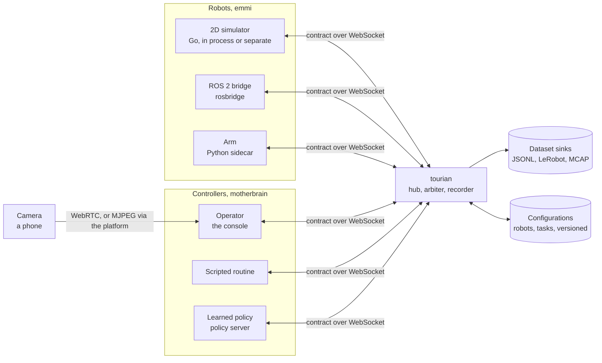

# Architecture

How tourian works, as it is now. [SCOPE.md](SCOPE.md) says what was planned, in which order and what is still missing; [AGENTS.md](AGENTS.md) how to work on it. The history of how it was built is at the end.

## The shape

The platform is one Go process in the middle. Robot adapters connect to it and announce their capabilities; consoles connect to it and see the fleet; controllers hold robots through it. The contract is the same on every edge, so the platform forwards, records and arbitrates without knowing what kind of robot or controller is on the other side.

Three languages, one contract: the Go module holds the platform and the adapters, an npm workspace holds the console and the generated TypeScript as the package `@tourian/contract`, and the Python under `gen/python` serves the sidecars. Every seam is an interface with at least two implementations: three robots, three controllers, three dataset sinks, two video paths.

## The contract

One Protobuf package, `tourian.v1`, under `proto/tourian/v1/`:

| File | What it defines |
| --- | --- |
| `header`, `geometry` | stamp and frame id, vectors, poses and twists, in ROS 2 shapes |
| `robot` | capabilities with limits and timeouts, velocity and joint commands with sequence numbers, acknowledgements, observations with pose, velocity, joints, battery and the halt reason, heartbeat, stop |
| `video` | camera announce, video requests, WebRTC signaling, MJPEG frames |
| `control` | who holds a robot and since when, handing over and releasing, the welcome that tells a console its id |
| `episode` | recording start and stop, status, flags, the frame and the episode metadata |
| `config` | robot and task configurations with versions |
| `transport` | the `Envelope`, a one-of over every message that crosses a seam |

`make generate` writes Go, TypeScript and Python into `gen/`; all three are committed and `make generate-check` fails CI if they drift from the `.proto` files.

## The platform

**The hub** is a switchboard with three WebSocket endpoints. Robot adapters connect to `/api/robot` and announce their capabilities in their first frame, cameras to `/api/camera` likewise, consoles to `/api/console` and are told their id, where the platform is reachable on the local network, every robot and camera known, and the latest state published per robot. Commands, joint commands, heartbeats and stops are routed to the robot they name; observations and acknowledgements fan out to every console; MJPEG frames go to the consoles that asked; signaling is routed by console id. The hub never looks inside a message beyond the robot id and the console id, so what sits on either side can change without it.

**One address for a phone.** The platform's endpoints live under `/api`; every other path is handed to the console's own server, so a phone reaches the page, the WebSocket and the fetches at one origin. The platform also listens over https with a certificate it makes for itself: a local authority, made once under `data/tls/` and served at `/api/ca.pem` for a phone to install, signs a server certificate for the machine's hosts and addresses, made again when they change. The console takes the platform to be the page's own origin; opened on its own port, 1499, it assumes the platform at its default port on the same host. There are no settings.

**Peers and limits.** Each peer writes from its own goroutine with a bounded queue, and one that cannot keep up is dropped rather than slowing the others; the robot behind a dropped connection stops on its own timeouts. A peer that does not announce itself within five seconds is dropped. Browsers are let in by origin, from the platform's own host on any port, from localhost, or from a host named in `-origins`, on the WebSocket endpoints and the HTTP alike; adapters send no origin and pass. There is no authentication until the platform is reachable from anywhere but a laptop.

**Taps and publishing.** Every message the hub receives, from any peer, goes to the taps before routing, with its source; the recorder and the arbiter are taps, each draining an inbox on its own goroutine so the hub never waits on them. The platform's own voice is `Publish`: the message goes to every tap and every console, and the latest of its kind per robot is retained for consoles that join later, so a console always knows who holds a robot and whether it is being recorded.

**The transport** is `transport/ws`: one `Envelope` per binary frame, its place and its ids found by reflection, so a new message needs no code. The console decodes the same frames with the generated TypeScript. `transport/httpjson` serves contract messages as JSON where things are fetched rather than streamed.

## The robots

**The adapter seam.** An adapter speaks the contract for one robot: it announces capabilities, turns commands into motion, reports observations, and keeps the safety story on its side. It connects to the platform as a client and reconnects when the platform goes away; what the adapters share, the reconnect loop, the write loop and the clamp, lives in `emmi`.

**Safety lives in the adapter.** The guard in `emmi/safety` holds a robot still until the first heartbeat, stops it when no command has arrived within the command timeout (500 ms) or no heartbeat within the heartbeat timeout (1 s), and applies an emergency stop the moment it arrives, ahead of anything queued, until the next command. Every observation carries the halt reason, so the console can say why the robot is not moving. The console contributes only the dead-man signal: a heartbeat with every command while the operator is engaged and the window has focus.

**The simulator**, `emmi/zebes`, is a differential drive in a square arena: pose, body velocity, wheel joints that follow from the drive, and a battery that drains with effort. It is stepped by an injected clock, so the tests run in no time, and runs at 50 Hz with observations at 20 Hz. It runs in the platform's process (`tourian -sim`, several with `-sims`) or its own (`cmd/zebes`).

**The ROS 2 bridge**, `emmi/rosbridge`, speaks the rosbridge protocol: velocity commands become `geometry_msgs/msg/Twist` on `/cmd_vel`; odometry, joint states and battery state become observations. It publishes the twist every 50 ms, zero within that tick of the operator not being heard, and a last zero on the way out whatever the reason, since a plain ROS robot keeps doing what it was last told. `rosbridgetest` is a simulated ROS robot behind the same protocol; `cmd/rossim` runs it on a port.

**The arm sidecar**, `sidecars/arm`, is Python, because the drivers of physical arms tend to be. `ArmDriver` is what it needs from an arm: named joints, positions, a target to move toward and a stop that holds; `FakeArm` stands in. It acknowledges each `JointCommand` on arrival, moves toward the target while the operator is heard and holds the arm the moment not, through a guard with the same semantics as the Go one. The hardware test waits for an arm.

**The contract tests**, `emmi/contracttest`, are what every adapter must do, exercised through a real hub: announce, drive on command and acknowledge it, stop when commands stop, stop when heartbeats stop, stop at once on an emergency stop ahead of five queued commands. Both Go adapters pass them under `make ci`; the sidecar has the same test in pytest.

## The controllers

**The controller seam.** A controller inside the platform is anything that can describe itself and turn an observation into a twist. Two exist: the scripted square, which drives a leg and turns a quarter by the clock on the observations, and the policy client, which posts the observation as JSON to a server's `/act` and reads a twist back, having asked the server at its root to describe itself; a server that does not is offered as a policy named by its host. `cmd/policy` stands in for a learned policy by steering home over that protocol, and `sidecars/script` is the Python way to write one: a script is one `act(observation)` function that `serve` puts behind the two requests under a name and a kind of its own. The operator is the third kind and speaks through the hub.

**The arbiter**, `motherbrain`, keeps one answer per robot to who is driving. A console hands a robot to a controller by name; the operator takes over by driving, since the hub asks the arbiter whether to admit each command, joint command and heartbeat from a console, and the first admitted one makes that console the holder and remembers who held it before; releasing hands the robot back to that controller, or to nobody. One operator at a time: while a console's operator holds a robot, another console's driving is refused before any tap sees it, and a holder silent for a second, disconnected or otherwise, leaves the robot in nobody's hands. An emergency stop from a console takes the robot out of every hand, the remembered one included.

**Acting.** While a controller inside the platform holds a robot, the arbiter calls it on every observation with a 40 ms budget, one call in flight per robot, and sends the robot a heartbeat and the command. A controller that fails or is late sends nothing, is complained about at most once a second, and the robot's own timeouts hold it still, so the safety story is unchanged by who is driving. Every change of hands is published as a `ControlState`, and the recorder stamps the holder on every frame.

## Video

**The camera is a peer like the robot.** A phone opens the console's `/camera` page, from the QR code the console shows where the picture will be, which takes the camera and connects to the hub's `/api/camera` endpoint, announcing which robot it is the eyes of. The console's video view shows the camera of the selected robot over the path chosen.

**The simulated camera** is the same page with `?source=world`: instead of a camera it follows every robot's observations as a console would and renders what the named robot sees, with three.js, in an arena the console furnishes (`world/arena.ts`: the square the simulator clamps to, walls and a few landmarks, drawn from above by the world canvas too), with the other robots in view; the canvas's stream is lent like a phone's, over either path. The simulator knows nothing of the furniture, so the robot drives through it; what this buys is pictures that match the state, so a recording of the simulator is an observation and action pair worth training on.

**WebRTC is peer to peer; the platform only signals.** The console offers a receive-only connection, the hub stamps the offer with the console's id and routes it to the camera, which answers with its track; the answer and the ICE candidates route back by the same id. The platform never touches the media, so it is not recorded. A link that fails, or is not up within eight seconds, is offered again from scratch, and the console shows the link's state beside the frame rate until it is up. There are no STUN or TURN servers while everything is on one network.

**MJPEG goes through the platform.** When a console asks, the camera page repaints its frames onto a canvas 640 wide, encodes each as JPEG at quality 0.7 and sends them at 15 fps as `VideoFrame` messages; the hub passes them to the consoles that asked and the camera stops when the last one has left. This path puts the frames in the platform's hands, which is what recording needs.

**Measuring the two.** With `?clock=1` the camera page composes a band of 32 black and white blocks across the top of every frame, encoding the time it was composed. With `?measure=1` the console reads the band back from every new frame and summarizes the frames' ages: the time from composition to display, which covers encoding, the path, decoding and rendering, and means something only when both pages share a clock. `make results-video` runs both pages in one headless Chrome with a fake camera and writes the figures under `docs/results/`; the first run gave WebRTC a median of 30 ms and MJPEG 36 ms with a p95 near 60 ms.

## Recording

**The recorder** is a tap on the hub. A console asks to record a robot; from then on each observation of that robot becomes a frame carrying the command in force, the holder and the sequence of the latest picture, until the console asks to stop. Pictures come over the MJPEG path, which the recorder requests from the camera for itself, as one more peer. It reports what it is writing to every console once a second, and a flag marks an episode bad with a note, during or after. Episode ids are the start time and the robot's id; the robot's and the task's configuration versions are stamped on the episode.

**Three sinks** write every episode:

- **JSONL**, a directory per episode under `data/episodes/`: `meta.json`, `frames.jsonl` of `EpisodeFrame` rows, the pictures as JPEG files and `video.jsonl` indexing them, all the contract's own messages as JSON, readable by eye and by anything. It is also what the platform serves for browsing and the console replays.
- **LeRobot v3.0**, one dataset per robot under `data/lerobot/<name>/<robot id>/`, since a dataset's state vector is laid out from one robot's joints: `info.json` with the features, `tasks.parquet` with the pandas metadata its reader expects, `stats.json` folded the way LeRobot's own aggregation does, one Parquet file and one episodes row per episode, and one MP4 per episode encoded with ffmpeg from the picture in force at each frame. Frames are stamped at the nominal rate, as LeRobot stamps them; `tourian.json` maps episode ids to indices and carries the flags, which the layout has no place for.
- **MCAP**, one file per episode under `data/mcap/`: `/observation`, `/action` and `/controller` as protobuf with the schema embedded, `/camera` and `/pose` as Foxglove's JSON schemas, so Foxglove's panels show them without being told how. A metadata record names the episode and carries its flag.

**Configurations** are versioned files under `data/config/`, every save a new version beside the earlier ones, so an episode can name the version it was recorded on and the file is still there. The platform serves them over HTTP and publishes a new robot configuration to consoles at once; a configuration can lower a robot's limits, never raise them.

## The console

Next.js with the App Router, one store (zustand) that the connection writes and the components read: the robots, cameras, control states and episode statuses of the fleet, and the trail and the last six seconds of speed, turn rate, battery and latency of the selected robot. A driver loop at 20 Hz reads the keyboard and the gamepad and, while engaged, sends a heartbeat and a command scaled to the robot's effective limits; for an arm, a robot with joints and no velocity limits, it sends the joint targets from a slider per joint instead, which start where the joints are so engaging moves nothing. Latency is the round trip of each command to its acknowledgement, matched by sequence number.

The control room draws the world on a canvas with the picture above it, telemetry with sparklines beside it, the control panel saying who holds the robot and whether this console's driving waits, the recording controls, and a fleet strip when there is more than one robot. The other pages are `/camera` for a phone, `/episodes` with the replay, and `/config`.

## Tooling

`make ci` is what hosted CI runs: golangci-lint, buf lint and format, Prettier, oxlint, tsc, markdownlint, ruff, the generation check, the Go tests under the race detector, the Vitest and pytest tests, the Go and Next.js builds, and the contract tests. `make tools` installs buf, protoc-gen-go and golangci-lint into `bin/` at pinned versions. `make screenshot` and `make results-video` build and serve the console and the platform and drive headless Chrome against them.

## Layout

| Directory | What it holds |
| --- | --- |
| `proto/` | the contract, and `buf` configuration |
| `gen/` | generated Go, TypeScript and Python, committed; `gen/ts` is the npm package `@tourian/contract` |
| `cmd/tourian` | the platform binary |
| `cmd/zebes` | the simulator as its own process |
| `cmd/policy` | a stand-in policy server that steers home |
| `cmd/rosbridge` | the rosbridge adapter as its own process |
| `cmd/rossim` | a simulated ROS 2 robot behind the rosbridge protocol |
| `config/` | the versioned configurations of robots and tasks, and their HTTP |
| `emmi/` | what the robot adapters share: the reconnect loop, the write loop and the clamp |
| `emmi/zebes` | the simulated robot: world and the connection to the platform |
| `emmi/rosbridge` | the adapter for a ROS 2 robot through rosbridge; `rosbridgetest/` the simulated one |
| `emmi/safety` | the guard every adapter shares |
| `emmi/contracttest` | what every adapter must do |
| `hub/` | the platform's routing between robots, cameras and consoles, with taps for the rest of the platform |
| `episode/` | the recorder, the JSONL sink, the HTTP for browsing; `lerobot/` the LeRobot v3.0 sink, `mcap/` the MCAP sink |
| `motherbrain/` | the controller seam and the arbiter; `script/` the square, `policy/` the client of a policy server |
| `transport/ws` | contract messages over WebSocket |
| `transport/httpjson` | contract messages as JSON responses |
| `console/` | the Next.js console: `platform/` connection and store, `drive/` inputs and latency, `world/` the arena from above and from the robot's eyes, `telemetry/` the panel, `video/` the viewers, the camera page's serving side and the clock band, `record/` the recording controls, `control/` the holder and the handover, `fleet/` the strip of robots, `config/` the configuration page, `episodes/` the list and the replay; `app/` the pages |
| `sidecars/arm` | the Python sidecar for a physical arm |
| `sidecars/script` | a controller as one Python function, served the way a policy server is; `examples/` has one |
| `scripts/` | what the make targets run |
| `docs/` | screenshots, and the measurements under `results/` |

## Not there yet

- A second transport beside WebSocket, for comparison, under `transport/`.
- A camera on the ROS robot or the arm; the camera is a phone's or the simulated robot's.
- Contact in the simulator: the furniture the camera sees is not in the robot's way.
- Authentication, before the platform is reachable from anywhere but a laptop.

## How it was built

All of it landed on 2026-11-10, milestone by milestone, followed by review, cleanup and hardening rounds on 2026-11-11.

- **M0, the toolchain and the first contract.** The repository, the three generators, the platform binary with a health endpoint, a console page listing the contract's messages, and the `make ci` gate.
- **M1, drive.** The hub and the WebSocket transport, the simulator with the safety behaviors in it, and the control room with the world, telemetry and latency.
- **M2, see.** The camera as a peer, WebRTC with the platform signaling, MJPEG through the platform, and the clock band that measures both.
- **M3, record.** The recorder as a tap, the JSONL and LeRobot sinks, flags, browsing and replay.
- **M4, hand over.** The controller seam with the square and the policy client, the arbiter, and the holder stamped into every frame.
- **M5, many.** Several simulated robots, the fleet strip, and versioned configurations of robots and tasks.
- **M6, real.** The rosbridge adapter with a simulated ROS robot, the safety guard extracted for every adapter, the contract tests, the MCAP sink, and the Python arm sidecar.
- **Review, cleanup, hardening.** The code read against the documents and itself, one operator at a time with a lease, frames only to those who asked, duplication folded, and origin checks, timeouts and fuzzing added.
