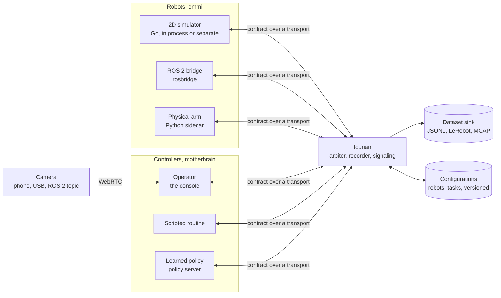

# Architecture

How tourian works, as built, with the planned shape below it until it is. [SCOPE.md](SCOPE.md) says what, in which order and what is still missing; [AGENTS.md](AGENTS.md) how to work on it.

## Built

Nothing yet.

## Planned

### The shape of it

The platform is one Go process in the middle. Robot adapters connect to it and announce their capabilities; consoles connect to it and see the fleet; controllers hold robots through it. The contract is the same on every edge, so the platform forwards, records and arbitrates without knowing what kind of robot or controller is on the other side.

### The contract

Protobuf packages under `proto/tourian/v1/`: `robot` (capabilities, observations, commands, heartbeat, stop), `control` (who holds a robot, takeover, handback), `episode` (recording start and end, flags, the frame layout), `config` (robot and task configurations with versions). Messages follow ROS 2 conventions where they exist.

### Where things will be

| Directory | What it holds |
| --- | --- |
| `proto/` | the contract, and `buf` configuration |
| `gen/` | generated Go and TypeScript, committed |
| `cmd/tourian` | the platform binary |
| `cmd/zebes` | the simulator, runnable on its own |
| `emmi/` | robot adapters: the simulator, rosbridge |
| `motherbrain/` | controllers: scripted, policy client; the arbiter |
| `transport/` | WebSocket, and later the others |
| `video/` | WebRTC signaling and the MJPEG path |
| `episode/` | recording and the dataset sinks |
| `console/` | the Next.js console |
| `sidecars/` | Python processes for hardware with Python-only drivers |
| `docs/` | results, screenshots |
