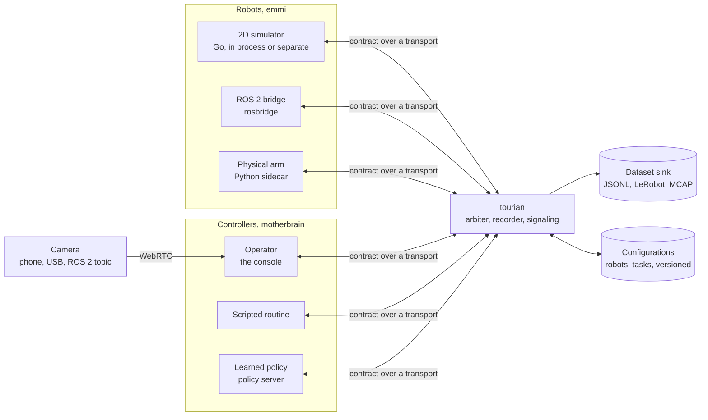

# Architecture

How tourian works, as built, with the planned shape below it until it is. [SCOPE.md](SCOPE.md) says what, in which order and what is still missing; [AGENTS.md](AGENTS.md) how to work on it.

## Built

### M0 — the toolchain and the first contract

One repository, two languages, one contract. The Go module `github.com/vlumi/tourian` holds the platform binary and, later, the adapters; an npm workspace at the root holds the console and the generated TypeScript as a package of its own, `@tourian/contract` in `gen/ts`, so the console imports contract types the way it imports any dependency and the bundler's root is the repository.

**The contract** is `proto/tourian/v1/`: `header.proto` (stamp and frame id, as std_msgs/Header), `geometry.proto` (Vector3, Point, Quaternion, Pose, Twist, as geometry_msgs) and `robot.proto` (Capabilities with velocity limits and the command timeout, VelocityCommand with a sequence number, Observation with pose, velocity, joints and battery and the sequence of the last command it reflects, JointState as parallel arrays, Heartbeat as the dead-man signal, Stop). `buf generate` writes Go with `protoc-gen-go` into `gen/go` and TypeScript with `protoc-gen-es` into `gen/ts`; both are committed, and `make generate-check` fails CI if they drift from the `.proto` files.

**The platform binary**, `cmd/tourian`, is an HTTP server with a health endpoint, the mount point for the WebSocket transport of M1.

**The console** is Next.js with the App Router. Its one page renders the name and lists the messages of the contract from the generated schemas, which proves the generation path end to end: proto to TypeScript to a server-rendered page.

**The gate**, `make ci`, is what hosted CI runs: golangci-lint with gofmt and goimports, buf lint and format, Prettier, oxlint, tsc, markdownlint, the generation check, Go and Vitest unit tests, and the Go and Next.js builds. `make tools` installs buf, protoc-gen-go and golangci-lint into `bin/` at the versions pinned in the Makefile; `make screenshot` builds and serves the console and captures it with headless Chrome.

## Planned

### The shape of it

The platform is one Go process in the middle. Robot adapters connect to it and announce their capabilities; consoles connect to it and see the fleet; controllers hold robots through it. The contract is the same on every edge, so the platform forwards, records and arbitrates without knowing what kind of robot or controller is on the other side.

### The contract

Protobuf packages under `proto/tourian/v1/`: `robot` (capabilities, observations, commands, heartbeat, stop), `control` (who holds a robot, takeover, handback), `episode` (recording start and end, flags, the frame layout), `config` (robot and task configurations with versions). Messages follow ROS 2 conventions where they exist.

### Where things will be

| Directory | What it holds |
| --- | --- |
| `proto/` | the contract, and `buf` configuration |
| `gen/` | generated Go and TypeScript, committed |
| `cmd/tourian` | the platform binary |
| `cmd/zebes` | the simulator, runnable on its own |
| `emmi/` | robot adapters: the simulator, rosbridge |
| `motherbrain/` | controllers: scripted, policy client; the arbiter |
| `transport/` | WebSocket, and later the others |
| `video/` | WebRTC signaling and the MJPEG path |
| `episode/` | recording and the dataset sinks |
| `console/` | the Next.js console |
| `sidecars/` | Python processes for hardware with Python-only drivers |
| `docs/` | results, screenshots |
