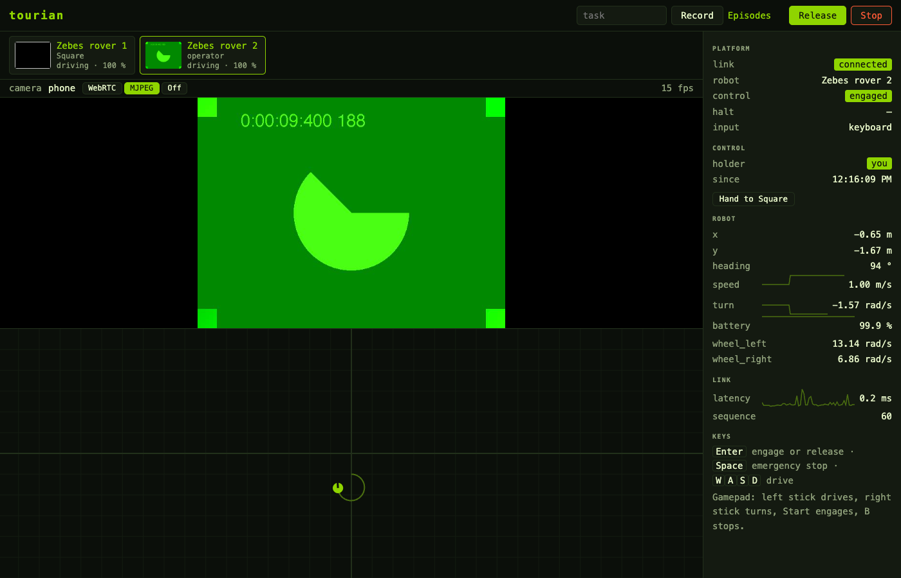
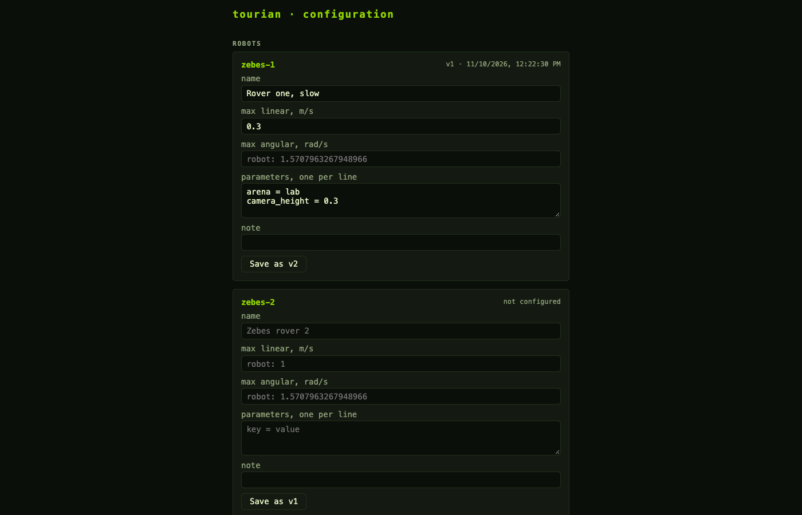
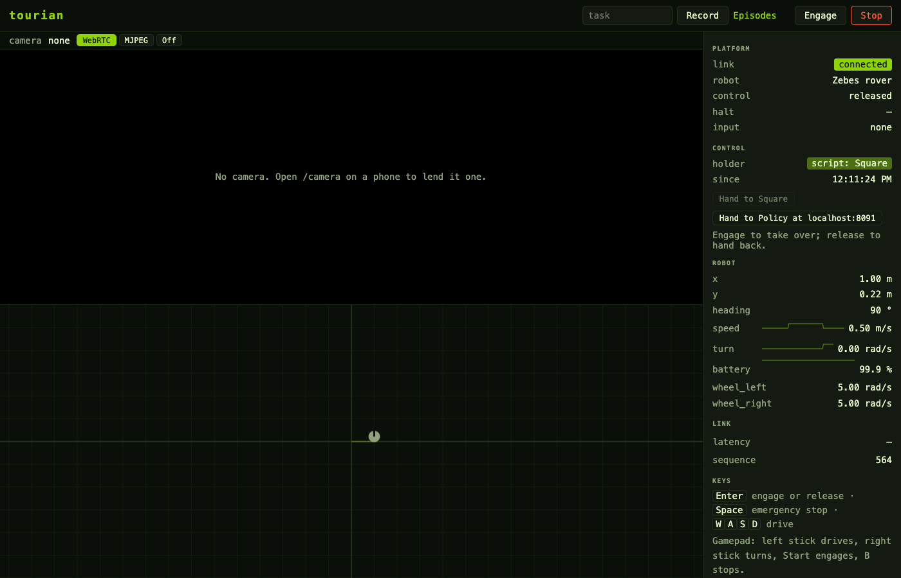
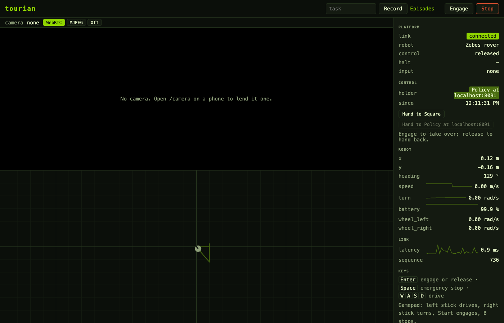
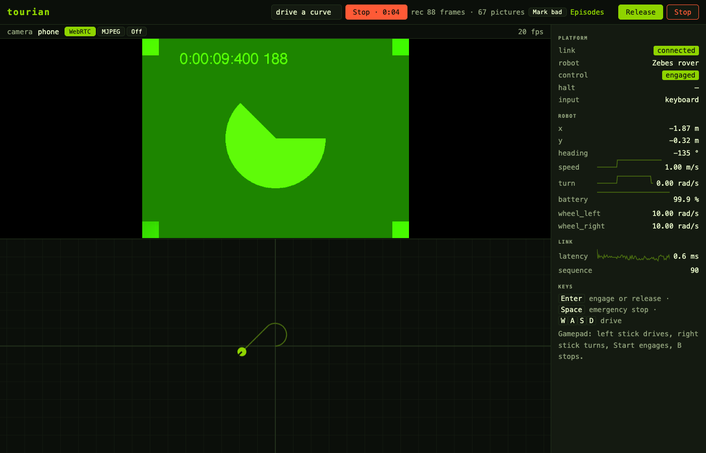
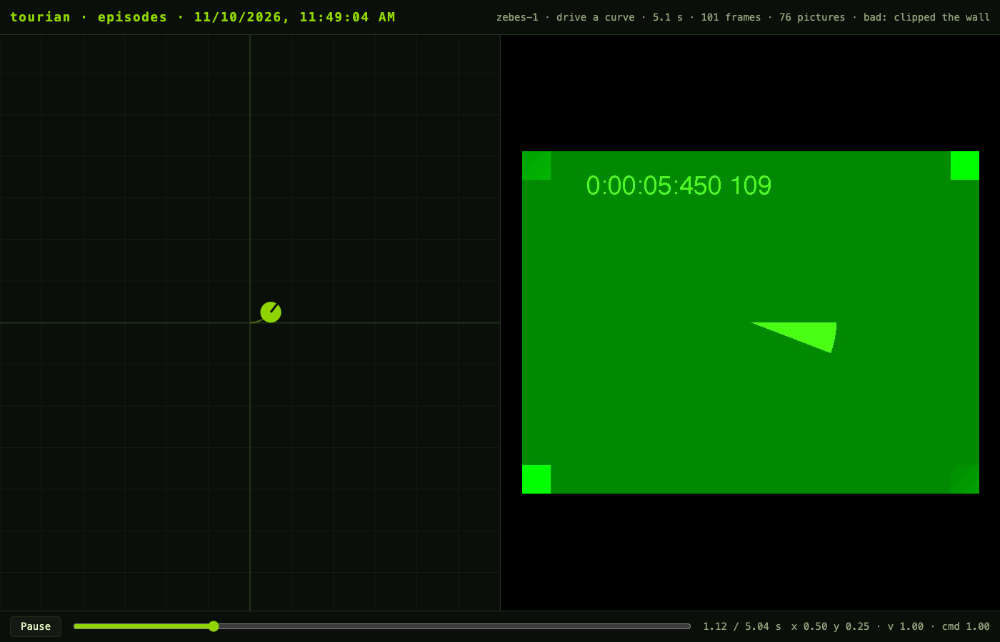
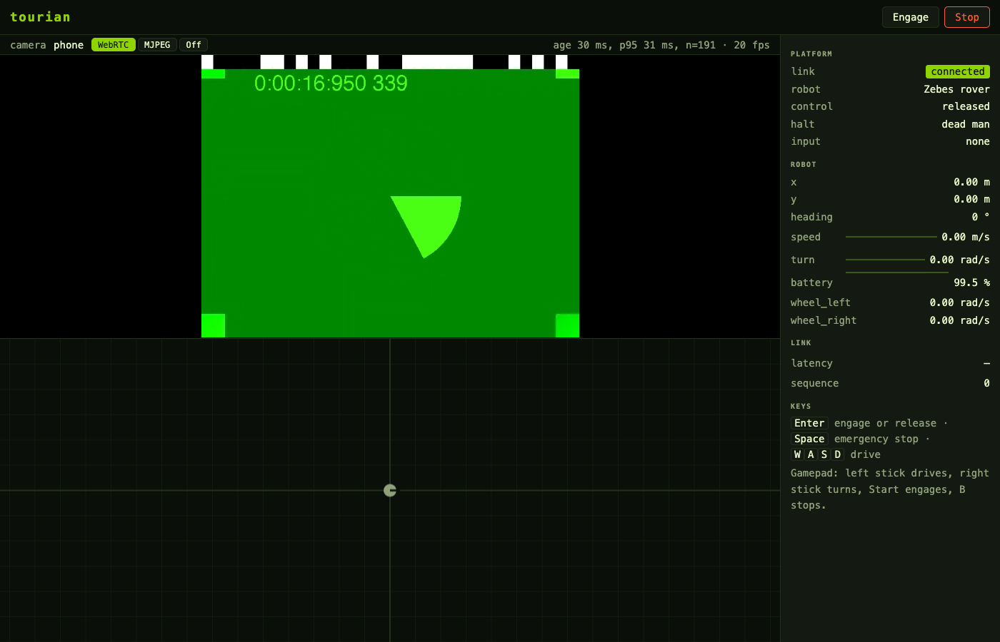
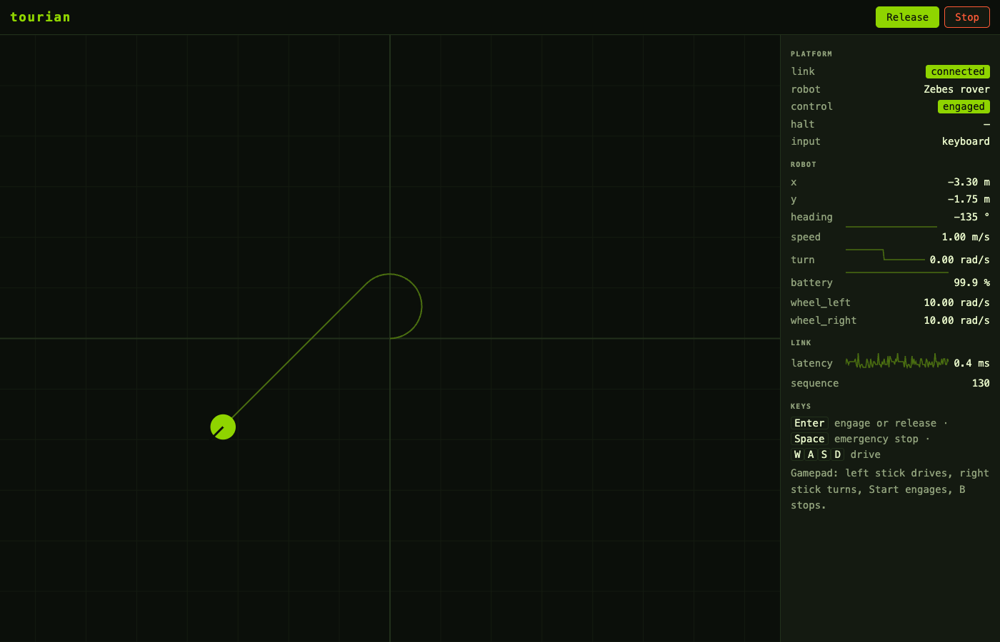

# Screenshots

One capture per milestone, taken with `make screenshot` (which builds and serves the console and runs [`scripts/screenshot.mjs`](../../scripts/screenshot.mjs) against it), newest first. The files carry a running number so they sort in order, then a name for what they show; the headings carry the dates.

## 2026-11-10 · Many

Two simulated robots under one platform: the fleet strip above the picture with a card each, the first driving its square under the script, the second selected and driven by the operator with its camera's picture on the card and above the world, where the first robot shows dimly.

The configuration page: a form per robot with a name of the operators' own, speed limits under the robot's, parameters and a note, each save a new version; and the tasks with their description and what success looks like.

## 2026-11-10 · Hand over

The scripted square holding the robot: the control section names the holder and since when, offers the square and the policy server to hand the robot to, and says that engaging takes over. The robot has driven the first leg and turned.

A moment later the stand-in policy server holds the robot and has brought it back near the origin, after the operator took over by engaging, drove backward, and released, which handed the robot back to the script first.

## 2026-11-10 · Record

The console recording: the task typed into the header, the record button with the running time, the frames and pictures written so far and the button that marks the episode bad, while the robot drives a curve on the camera's picture and the world below.

The same episode replayed from the episodes page a moment later: the world as recorded on the left, the picture in force on the right, the slider and the frame's figures along the bottom, the flag and its note in the header.

## 2026-11-10 · See

The camera's picture above the world, over WebRTC, with the clock band across its top during a latency measurement; the fake camera of headless Chrome stands in for a phone. The path toggle sits in the bar above the picture with the frame rate at its right.

## 2026-11-10 · Drive

The console engaged and driving the simulated robot over WebSocket: the arena with its meter grid and the trail of a left turn followed by a straight run, the telemetry panel with the link, the robot's pose, speed, turn rate, battery and wheel speeds, sparklines beside the figures, and the round-trip latency of each command measured from its acknowledgement, under a millisecond on the same machine. Taken with the platform running the simulator in-process and the keys scripted.

## 2026-11-10 · Bootstrap

The console's first page: the name, the tagline and the seven messages of the first contract, read from the generated TypeScript schemas at render time.
