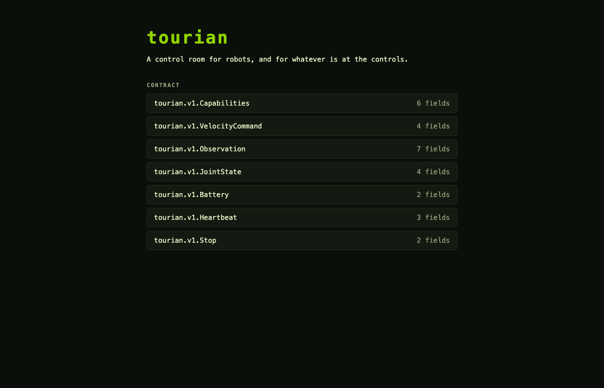

# Screenshots

One capture per milestone, taken with `make screenshot` (which builds and serves the console and runs [`scripts/screenshot.mjs`](../../scripts/screenshot.mjs) against it), newest first. The files carry a running number so they sort in order, then a name for what they show; the headings carry the dates.

## 2026-11-10 · Bootstrap

The console's first page: the name, the tagline and the seven messages of the first contract, read from the generated TypeScript schemas at render time.
